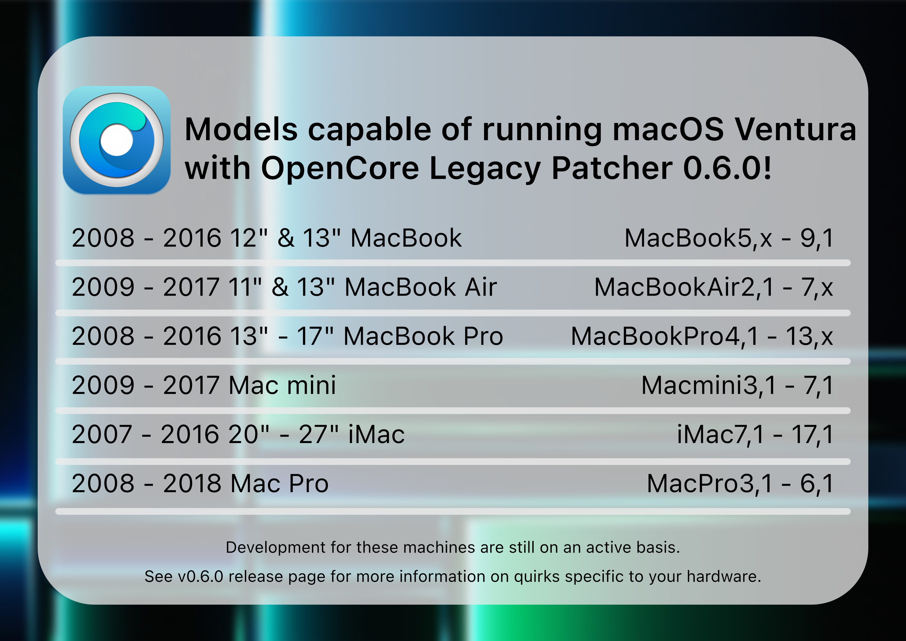

# macOS Ventura

With the release of OpenCore Legacy Patcher v0.5.0 and newer, early support for macOS Ventura has been implemented for most Metal-capable Macs. This page will be used to inform users regarding current issues and will be updated as new patch sets are developed and added to our patcher.

## Newly dropped hardware

Ventura's release dropped a large amount of Intel hardware, thus requiring the usage of OpenCore Legacy Patcher on the following models (in addition to previously removed models):

* iMac16,1 (21.5-inch, Late 2015)
* iMac16,2 (21.5-inch and 21.5-inch 4K, Late 2015)
* iMac17,1 (27-inch 5K, Late 2015)
* MacBook9,1 (12-inch, Early 2016)
* MacBookAir7,1 (11-inch, Early 2015)
* MacBookAir7,2 (13-inch, Early 2015)
* MacBookPro11,4 (15-inch, Mid 2015, iGPU)
* MacBookPro11,5 (15-inch, Mid 2015, dGPU)
* MacBookPro12,1 (13-inch, Early 2015)
* MacBookPro13,1 (13-inch, Late 2016)
* MacBookPro13,2 (13-inch, Late 2016)
* MacBookPro13,3 (15-inch, Late 2016)
* Macmini7,1 (Late 2014)
* MacPro6,1 (Late 2013)

## Current status

OpenCore Legacy Patcher supports Ventura for the models below, however some challenges remain. You can find information about them further down on this page.

## Current issues

[See ongoing issues.](https://dortania.github.io/OpenCore-Legacy-Patcher/ONGOING-ISSUES.html)

